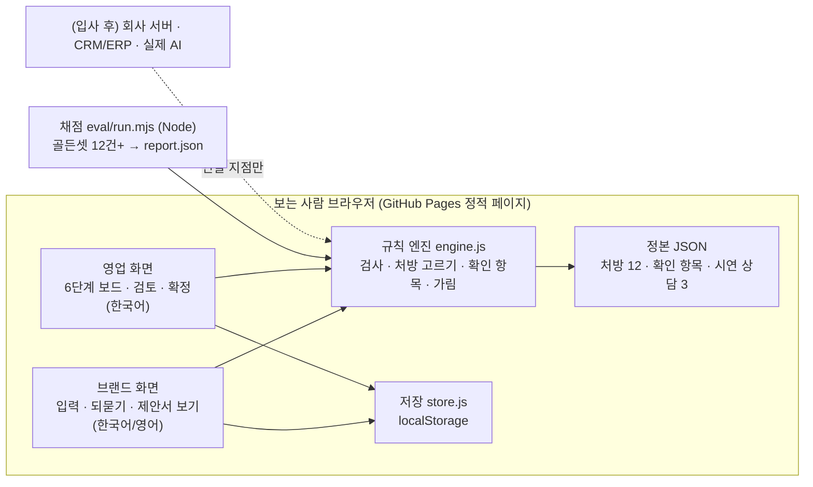

# 아키텍처

> 상태: 초안(승인 대기) · 2026-11-24 · 근거: [requirements.md](requirements.md)

## 1. 구성도

- 서버가 없어요. 페이지와 JSON 파일만 올려요. 외부로 보내는 요청은 0건이에요(AC-24).
- 규칙 엔진 하나를 브라우저와 채점 스크립트가 같이 써요. 그래서 채점 결과가 화면 동작과 같아요.

## 2. 구성 요소 역할

| 파일 | 역할 | 관련 AC |
|---|---|---|
| `site/index.html` | 화면 틀, 역할 전환 버튼, 초기화 버튼, 가상 시연 안내 | AC-01 · 06 · 29 |
| `site/css/style.css` | 회사 홈페이지 색 토큰(남색 · 올리브 · 숲 초록 · 흙갈색 · 회색) | AC-30 |
| `site/js/i18n.js` | 한국어/영어 문구 | AC-21 |
| `site/js/engine.js` | ① 필수 칸 검사 · 되묻기 판단 ② 처방 고르기(최대 3개, 이유) ③ 최소 주문 수량 · 일정 표시 ④ 나라별 확인 항목 · 근거 없음 처리 ⑤ 연구소 요청 초안(연락처 가림) | AC-03~16 · 27 · 28 |
| `site/js/store.js` | 상담 저장 · 단계 바꾸기 · 기록 1줄 · 초기화 | AC-05 · 17 · 23 · 29 · 32 |
| `site/js/app.js` | 화면 그리기, 확정 버튼 잠금, 제안서 보기 · 인쇄 | AC-18~22 |
| `site/data/*.json` | 정본 데이터(데이터 설계 참고) | AC-07 · 12 |
| `eval/golden.json` · `eval/run.mjs` | 골든셋 채점, 지표 4개 → `eval/report.json` | AC-26 · 27 |
| `tests/engine.test.mjs` | 엔진 단위 시험(Node 기본 시험 도구) | AC 전반 |

## 3. 호출 흐름 (요약)

1. 브랜드 화면에서 제출 → `engine.checkRequired()` → 빈 필수 칸이 있으면 되묻기 화면(1번).
2. 다시 제출 → 남은 빈칸은 '미정' → `store.save(단계=문의)` → `engine.suggest()` → `store.move(검토)`.
3. 영업 화면에서 후보를 보고 처방 · 단가 · 납기 입력 → 3칸이 다 차면 '확정' 열림 → `store.move(제안)` → 제안서(문의 언어).
4. 이후 단계(샘플 · 수주 · 보류)는 영업이 직접 바꿔요. 바꿀 때마다 기록 1줄.

자세한 순서는 [flows.md](flows.md).

## 4. 입사 후 연결 지점 (지금은 만들지 않음)

| 지금 | 입사 후 | 지킬 것 |
|---|---|---|
| `engine.suggest()` 규칙 | 회사 서버의 AI 호출로 바꿈. 같은 입력 · 출력 모양 유지 | 연락처 · 브랜드명을 가린 뒤 전송, 회사 보안 규정 확인(Q8) |
| `store.js` localStorage | 회사 CRM · ERP 저장 | 볼 권한(영업 · 팀장), 보관 기간 |
| `data/formulas.json` 가상 | 연구소 처방 목록 | 연구소가 주인 |
| `data/checks.json` 시작 목록 | 인허가 담당이 관리 | 출처 링크 필수 |
