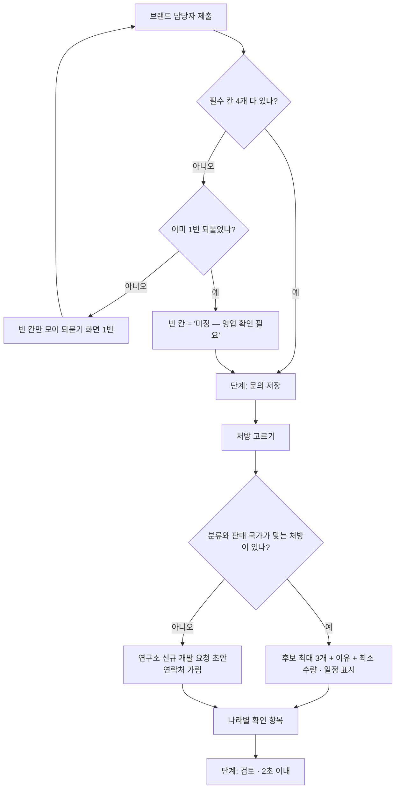
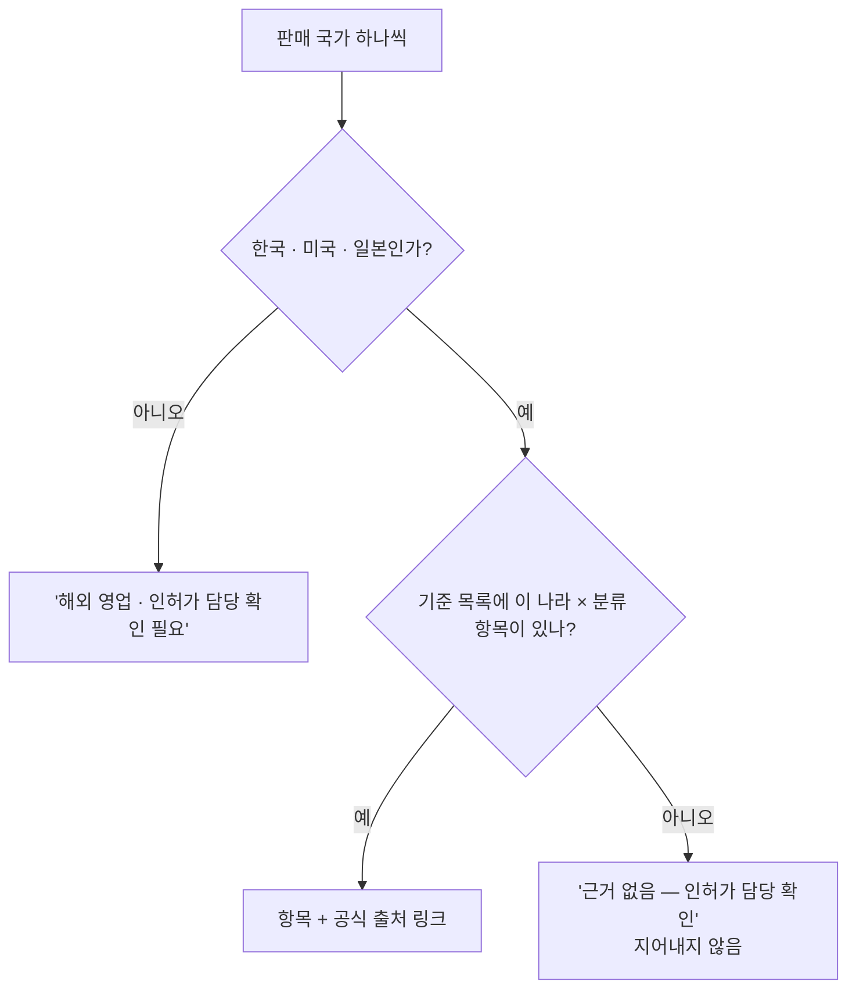
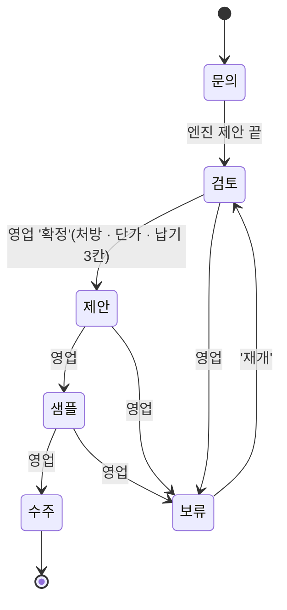

# 흐름 설계

> 상태: 초안(승인 대기) · 2026-11-24 · 근거: [requirements.md](requirements.md)

## F1. 상담 입력 → 되묻기 → 제안 초안

- **끝 조건:** 되묻기는 1번뿐이에요. 두 번째 제출은 빈칸이 있어도 반드시 '검토'로 가요(AC-04).

## F2. 처방 고르기 규칙

1. 같은 분류(제품 종류)만 남겨요.
2. 판매 국가를 모두 지원하는 처방만 남겨요. 남은 게 0개면 연구소 요청(AC-11).
3. 순서: 효능 · 컨셉 낱말이 많이 겹칠수록 위 → 최소 주문 수량을 넘으면 위 → 기간이 짧으면 위.
4. 위에서 3개까지. 각 후보에 이유(맞은 조건 · 안 맞은 조건)를 붙여요.
5. 첫 주문 수량이 최소 주문 수량보다 적으면 '최소 주문 수량 미달 — 영업 확인'(AC-10). 수량이 미정이면 '수량 미정 — 영업 확인'.
6. 오늘 + 기간(주)으로 예상 출고 시기 범위를 내요. 출시 희망 월보다 늦으면 '희망 월보다 늦을 수 있음'.

## F3. 나라별 확인 항목

- 묶음 위에 "AI 판단이 아니라 확인할 목록입니다" 1줄(AC-16).
- 모든 분류에 해당하는 공통 항목(`*`)은 늘 보여 줘요. '근거 없음'은 **이 제품 종류 전용 항목**이 0개일 때 붙여요(예: 일본 × 메이크업).

## F4. 진행 단계 (상태 기계)

- 사람만 단계를 바꿔요(문의 → 검토만 자동). 바꿀 때마다 기록 1줄(AC-23).
- **끝 조건:** 자동으로 다시 도는 곳이 없어요. 보류는 사람이 '재개'를 눌러야 움직여요(AC-32).
- 제안 → 검토로 되돌리기(확정 취소)는 이번에 만들지 않아요. 고치려면 보류 → 재개를 써요.

## F5. 영업 확정 → 제안서

1. 후보 중 하나 또는 '연구소 요청'을 고름 → 단가 · 납기 입력(AI가 미리 채우지 않음).
2. 3칸이 다 차야 '확정' 열림(AC-19).
3. 확정 → 제안서: 문의 언어로, 'AI 제안'(후보 이유 · 확인 항목)과 '영업 확정'(처방 · 단가 · 납기) 구역을 나눠 보여 줌. 인쇄 버튼.

## F6. 채점 (골든셋)

`node eval/run.mjs` → 골든셋마다 엔진을 돌림 → 지표 4개 계산 → `eval/report.json`.
1. 후보 3개 안 정답 비율 2. 되묻기 정확 비율 3. 확인 항목 출처 표시율 4. 공격 차단 비율(지시 바꿔치기 · 연구소 요청에 연락처 새는지).
